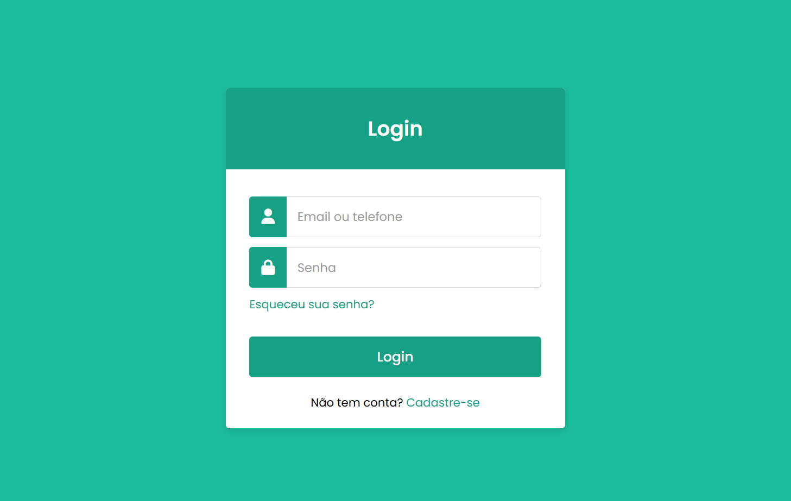

# 🔐 Formulário de Login

Projeto de uma interface de login, desenvolvido com **HTML5 e CSS3** como parte de uma atividade prática do curso PROA.

O projeto tem como objetivo explorar conceitos de criação e estilização de formulários web, organização de campos de entrada e aplicação de efeitos visuais interativos, utilizando recursos nativos do HTML e CSS.

## 🖥️ Prévia do projeto

  

🔗 **[Acesse o projeto online](https://gabrielc0liveira.github.io/Projeto6Proa-FormulariodeLogin/)**

## Funcionalidades e características

- Interface de login com campos para e-mail ou telefone e senha.
- Validação nativa de preenchimento obrigatório utilizando o atributo `required`.
- Campo de senha com caracteres ocultos.
- Ícones personalizados para identificação dos campos.
- Efeitos visuais ao selecionar os campos de entrada.
- Botão de login com efeito de alteração de cor ao passar o mouse.
- Links ilustrativos para recuperação de senha e cadastro.
- Formulário centralizado com estilização em tons de verde.

## Tecnologias utilizadas

- **HTML5:** estruturação do formulário, campos de entrada e validação nativa.
- **CSS3:** estilização, posicionamento, efeitos visuais e transições.
- **Font Awesome:** utilização de ícones nos campos do formulário.
- **Google Fonts:** utilização da fonte Poppins.

## Aprendizados

Durante o desenvolvimento, foram praticados conceitos como:

- Estruturação de formulários utilizando HTML.
- Utilização de diferentes tipos de inputs, como `text`, `password` e `submit`.
- Aplicação de validação nativa com o atributo `required`.
- Centralização de elementos utilizando Flexbox.
- Posicionamento de ícones dentro dos campos com `position: absolute`.
- Personalização de campos utilizando `:focus` e `::placeholder`.
- Criação de efeitos interativos utilizando `transition` e `hover`.

## 📂 Como executar o projeto

🔗 **[Acesse o projeto online](https://gabrielc0liveira.github.io/Projeto6Proa-FormulariodeLogin/)**

---

Desenvolvido por **Gabriel Oliveira** como parte das atividades práticas do PROA.
